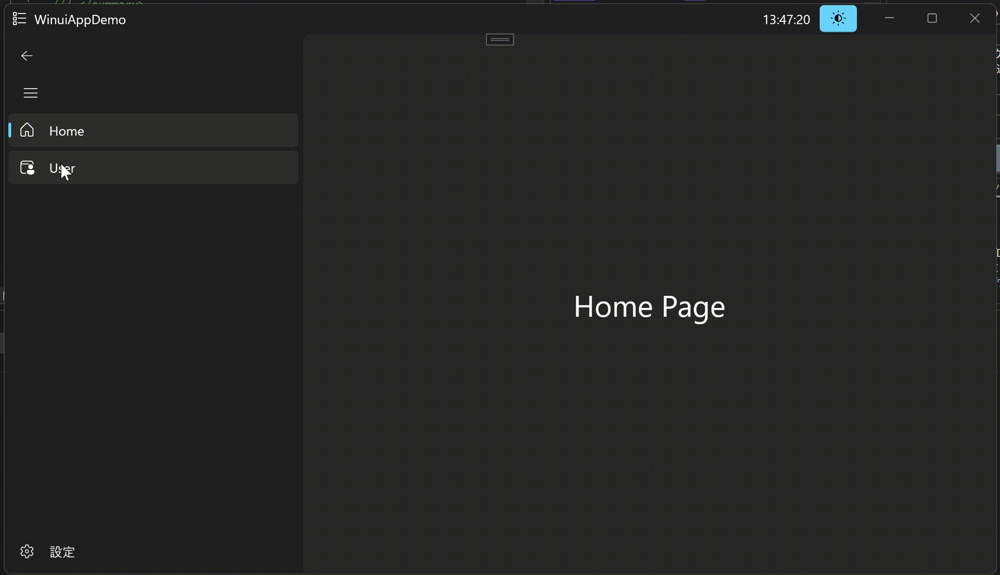
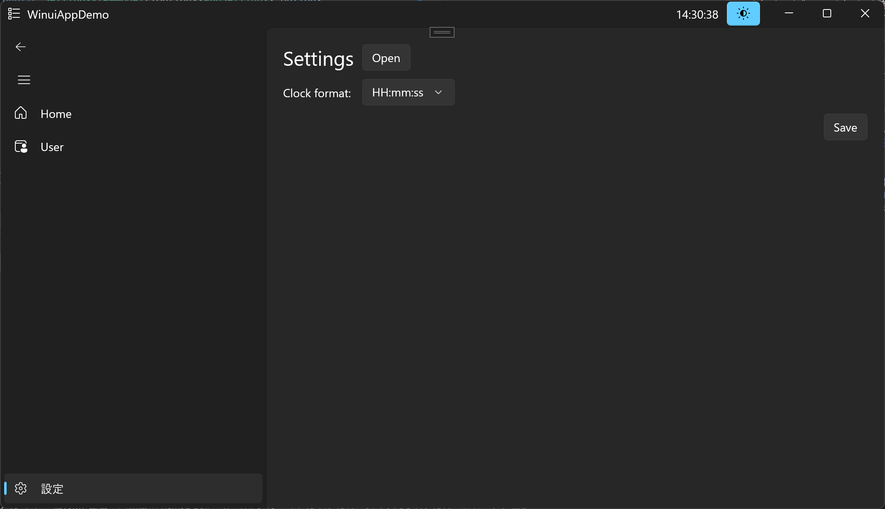

<div align="center">
  
</div>

# :book: Overview

<!-- [](./README.md) -->
[](./README.md)
[](./LICENSE)

[](https://www.microsoft.com/ja-jp/windows?r=1)
[](https://learn.microsoft.com/ja-jp/dotnet/csharp/)
[]([./README.md](https://dotnet.microsoft.com/ja-jp/))

このリポジトリでは、Windows App SDK (WinUI3) と C# を使用して構築された、モダンなWindowsデスクトップアプリケーションのサンプルを提供します。

MVVMデザインパターン、依存性の注入 (DI)、設定管理、ロギングなど、現代的なアプリケーション開発におけるベストプラクティスを学ぶための実践的なリソースとなることを目的としています。

> [!note]
> C++版: [r-dev95/CppWinuiAppDemo](https://github.com/r-dev95/CppWinuiAppDemo)

## :sparkles: Features

<div align="center">
  
</div>

### 動的なUI更新

* タイトルバーに現在時刻をリアルタイムで表示
* ライトモードとダークモードのテーマ切り替え

### ページナビゲーション

* `NavigationView` を使用した複数ページ間の遷移

### 永続的な設定管理

* 時計の表示形式 (24時間/12時間) を設定ページから変更
* 変更した設定は `userSettings.json` ファイルに保存され、次回起動時も維持

### ファイルアクセス

* 設定ファイルが保存されているフォルダをエクスプローラーで開く機能

### ロギング

* NLogによるアプリケーションの動作ログ記録

## :hammer_and_wrench: Technology Stack

* **UIフレームワーク:** Windows App SDK / WinUI 3
* **言語:** C#
* **プラットフォーム:** .NET 8
* **アーキテクチャ:** MVVM (Model-View-ViewModel)
* **MVVMツールキット:** [CommunityToolkit.Mvvm](https://learn.microsoft.com/ja-jp/dotnet/communitytoolkit/mvvm/)
* **依存性の注入:** [Microsoft.Extensions.Hosting](https://learn.microsoft.com/ja-jp/dotnet/core/extensions/generic-host?tabs=appbuilder)
* **ロギング:** [NLog](https://nlog-project.org/)

## :rocket: Getting Started

### 前提条件

#### [Visual Studio 2022](https://visualstudio.microsoft.com/ja/vs/)

* .NET デスクトップ開発ワークロード
* ユニバーサル Windows プラットフォーム開発ワークロード

#### [.NET 8 SDK](https://dotnet.microsoft.com/ja-jp/download/dotnet/8.0)

* [Windows App SDK](https://learn.microsoft.com/ja-jp/windows/apps/windows-app-sdk/downloads)

### インストールと実行手順

#### インストール

```bash
git clone https://github.com/r-dev95/WinuiAppDemo.git
```

#### ソリューションのオープン

`WinuiAppDemo.sln` ファイルを開きます。

#### NuGetパッケージの復元

Visual Studioが自動的に必要なパッケージを復元しますが、もし復元されない場合は、ソリューションエクスプローラーでソリューションを右クリックし、「NuGet パッケージの復元」を選択してください。

#### 実行

Visual Studioの上部ツールバーにある緑色の再生ボタン（`WinuiAppDemo (Package)`）をクリックするか、`F5`キーを押してデバッグを開始します。

## :file_folder: Project Structure

このプロジェクトは、関心事の分離を促進するためにMVVMパターンに基づいて構成されています。

```bash
WinuiAppDemo/
├── Models/         # アプリケーションのデータ構造を定義
├── Views/          # UIを定義するXAMLページとコードビハインド
├── ViewModels/     # UIのロジックと状態を管理
├── Services/       # ビジネスロジックや共通機能を提供
│   └── Interfaces/ # Serviceの実装を抽象化するインターフェース
├── App.xaml.cs     # DIコンテナの設定、サービスの登録、アプリの起動処理
└── MainWindow.xaml # アプリケーションのメインウィンドウ
```

## :key: ライセンス (License)

このリポジトリは [MIT License](./LICENSE.txt) の下でライセンスされています。
